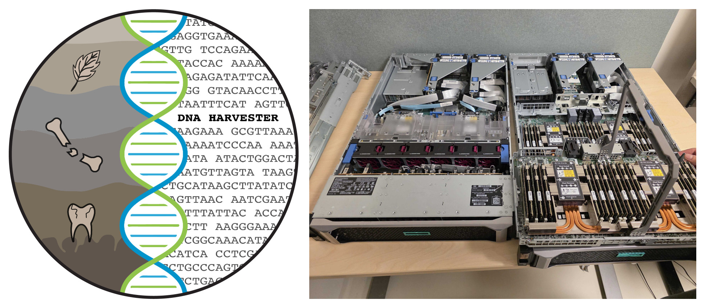

## September 2026
# Harvesting the true ancient DNA molecules
"*I look at the natural geological record, as a history of the world imperfectly kept, and written in a changing dialect,"* by Charles Darwin, On the Origin of Species (1859).

&nbsp;

## The challenges of ancient DNA
Anyone who has worked with ancient or historical specimens knows the feeling. You finally get your sequencing data back and most of it is not your target species. Ancient DNA molecules are short, chemically damaged and usually a tiny fraction of what is in the extract. Cytosine deamination leaves C-to-T substitutions clustered at DNA fragment ends [**1**], microbes, animals and people leave their own DNA behind, and short sequences from all of these sources can find a comfortable, but wrong, home on your data. Human contamination can persist in faunal datasets even after mapping to the target reference [**2**], and the shortest and most damaged sequences are the ones most likely to favor reference alleles, while alternative sequences might struggle to map and be underrepresented, a problem known as reference bias [**3**].
None of this is new, and the community has developed many clever tools to deal with each piece of it. The practical problem is stitching them together in a consistent, documented and reproducible way from one project to the next.
&nbsp;

## Building a pipeline
This is the gap that our AaRCTikTalks speaker Bilal Sharif and his colleagues from the Centre for Palaeogenetics (CPG) at Stockholm University and NBIS/SciLifeLab set out to fill with **DNAharvester**, a modular Nextflow pipeline specifically tailored for highly degraded DNA, recently published in Bioinformatics [**4**]. It joins other community efforts such as nf-core/eager [**5**] in pushing the field towards portable and reproducible analyses, with a strong focus on recovering and authenticating ancient DNA sequences from low-endogenous, contaminated samples.

&nbsp;

<em>DNAharvester: a Nextflow pipeline for ancient DNA analysis. The right photo depicts the assembling of a high-performance compute cluster. Logo and photo by Bilal Sharif.</em>

&nbsp;

The core of the pipeline combines four ideas:
-	Metagenomic pre-filtering. Optional metagenomic screening with Kraken2 removes microbial reads before they ever have the chance to map to a given reference genome.
-	Competitive mapping. Reads are then mapped against the target genome plus decoy genomes (e.g. human) concatenated into a single reference, thus reads face a competitive mapping process where only those uniquely assigned to the target are kept.
- Adaptive aligner choice. Users can pick BWA-aln for short reads, BWA-mem for longer ones, Bowtie2, or a hybrid BWA-aln/mem mode that splits reads at a configurable length, in order to adapt the pipeline to their specific needs.
- Damage and bias evaluation. After mapping-quality filtering and duplicate removal, the pipeline evaluates the alignments with AMBER [6], quantifies damage with MapDamage2 [**7**], and corrects it.

Around this core sit subworkflows for repeat and CpG masking, mitogenome assembly, taxonomic classification, microbial and pathogen screening, sex determination, and adaptive variant calling depending on sequencing depth [**4**].
&nbsp;

## Putting it to the test
To see how each filtering step changes the result, the authors simulated five datasets with an elephant genome as the mapping target, ranging from a clean modern-like sample to a highly contaminated one, a highly degraded one and a negative control.
The pattern was clear. In the heavily contaminated simulation, standard mapping gave a precision of only 84.08%, which competitive mapping pushed up to 99.92%. Adding metagenomic filtering on top of competitive mapping raised precision further in another sample, from 92.11% to 95.53%. In the most degraded simulation precision rose from 67.87% to 75.98% with practically no loss in recall, and in the negative control the combined approach produced the fewest spurious reads. As authors properly acknowledged, there is no universally best approach to align your data: you are choosing a point on a precision/recall trade-off, and the right choice depends on your specific research question.
&nbsp;

## Beyond the nuclear genome
The pipeline also delivered on its side quests. Mitogenomes were assembled to over 95% completeness when enough reads were present, with errors concentrated in the repetitive parts of the genome. Taxonomic classification placed the correct species mitogenome as the top hit in every simulated sample. The microbial screen picked up artificially inserted bacterial reads in all samples except the negative control, and they carried the damage pattern expected for ancient DNA. Finally, on an empirical set of 11 human samples, the sex determination module correctly classified all five karyotypes present (XX, XY, XXY, XYY and X0).
&nbsp;

## Costs and caveats
Mapping is where most of the time and computational resources go, accounting for 90 to 99% of total CPU time, which scaled linearly with input size. Processing 100 million read pairs against the 3.4 Gb Asian elephant genome took around 282 CPU-hours, a useful number to have when planning an allocation. In this regard, Bilal rightfully pointed to GPU-accelerated aligners as a way forward to save precious computational resources and time, something he has recently developed with G-ALN, a GPU implementation of BWA-aln [**8**]. However, a few things are worth keeping in mind. Most benchmarks rely on simulated data, which is the only way to know the ground truth but cannot capture every quirk of real samples. The microbial screen is designed as a quick first look rather than a replacement for dedicated metagenomic tools, and Y-chromosome ratios are reported for the user to interpret rather than turned into automatic calls, since Y assemblies vary so much between references.
&nbsp;

## Why DNAharvester matters
For many of us, especially those working on non-model or extinct animals, the bottleneck is less about any single algorithm and more about running a sensible, well-documented chain of decisions on every sample. DNAharvester packages those decisions, from decoy mapping to damage handling to coverage-aware genotyping, into one open-source reproducible workflow. That makes it easier to compare results across projects and easier for newcomers to get started without reinventing the pipeline. The code and documentation are freely available on Github (https://github.com/NBISweden/DNAharvester).

&nbsp;

## References
1.	[Briggs AW, Stenzel U, Johnson PLF, et al. Patterns of damage in genomic DNA sequences from a Neandertal. Proc. Natl. Acad. Sci. U. S. A. 104: 14616–14621 (2007).]
2.	[Feuerborn TR, Palkopoulou E, van der Valk T, et al. Competitive mapping allows for the identification and exclusion of human DNA contamination in ancient faunal genomic datasets. BMC Genomics 21: 844 (2020).]
3.	[Günther T, Nettelblad C. The presence and impact of reference bias on population genomic studies of prehistoric human populations. PLoS Genet. 15: e1008302 (2019).]
4.	[Sharif B, Kutschera VE, Oskolkov N, Guinet B, Lord E, Chacón-Duque JC, Oppenheimer J, van der Valk T, Díez-del-Molino D, Heintzman PD, Dalén L. DNAharvester: a nextflow pipeline for analysing highly degraded DNA from ancient and historical specimens. Bioinformatics 42: btag782 (2026).]
5.	[Fellows Yates JA, Lamnidis TC, Borry M, et al. Reproducible, portable, and efficient ancient genome reconstruction with nf-core/eager. PeerJ 9: e10947 (2021).]
6.	[Dolenz S, van der Valk T, Jin C  et al.  Unravelling reference bias in ancient DNA datasets. Bioinformatics 40: btae436 (2024).]
7.	[Jónsson H, Ginolhac A, Schubert M et al.  mapDamage2.0: fast approximate Bayesian estimates of ancient DNA damage parameters. Bioinformatics 29: 1682–4 (2013).]
8.	[Sharif B, Hedfors K, van der Valk T, Heintzman PD, Dalén L. G-ALN: a GPU-accelerated BWA-aln algorithm for palaeogenomics. bioRxiv. 10.64898/2026.10.18.759956 (2026).]

[Briggs AW, Stenzel U, Johnson PLF, et al. Patterns of damage in genomic DNA sequences from a Neandertal. Proc. Natl. Acad. Sci. U. S. A. 104: 14616–14621 (2007).]:https://doi.org/10.1073/pnas.0704665104
[Feuerborn TR, Palkopoulou E, van der Valk T, et al. Competitive mapping allows for the identification and exclusion of human DNA contamination in ancient faunal genomic datasets. BMC Genomics 21: 844 (2020).]:https://link.springer.com/article/10.1186/s12864-020-07229-y
[Günther T, Nettelblad C. The presence and impact of reference bias on population genomic studies of prehistoric human populations. PLoS Genet. 15: e1008302 (2019).]:https://doi.org/10.1371/journal.pgen.1008302
[Sharif B, Kutschera VE, Oskolkov N, Guinet B, Lord E, Chacón-Duque JC, Oppenheimer J, van der Valk T, Díez-del-Molino D, Heintzman PD, Dalén L. DNAharvester: a nextflow pipeline for analysing highly degraded DNA from ancient and historical specimens. Bioinformatics 42: btag782 (2026).]:https://doi.org/10.1093/bioinformatics/btag782
[Fellows Yates JA, Lamnidis TC, Borry M, et al. Reproducible, portable, and efficient ancient genome reconstruction with nf-core/eager. PeerJ 9: e10947 (2021).]:https://peerj.com/articles/10947/
[Dolenz S, van der Valk T, Jin C  et al.  Unravelling reference bias in ancient DNA datasets. Bioinformatics 40: btae436 (2024).]:https://doi.org/10.1093/bioinformatics/btae436
[Jónsson H, Ginolhac A, Schubert M et al.  mapDamage2.0: fast approximate Bayesian estimates of ancient DNA damage parameters. Bioinformatics 29: 1682–4 (2013).]:https://doi.org/10.1093/bioinformatics/btt193
[Sharif B, Hedfors K, van der Valk T, Heintzman PD, Dalén L. G-ALN: a GPU-accelerated BWA-aln algorithm for palaeogenomics. bioRxiv. 10.64898/2026.10.18.759956 (2026).]:https://www.biorxiv.org/content/10.64898/2026.10.18.759956v1

&nbsp;

Below, Bilal shared with us further details about his profile, career, prospects and future projects:
&nbsp;

**1. Briefly introduce yourself. What is your origin story for how you got into science?**  
I am Bilal Sharif, originally from Pakistan. I did my bachelor's in Plant Breeding and Genetics in Faisalabad, Pakistan, and then received a scholarship to pursue a master's in Plant Breeding at UniLaSalle Beauvais, France. 
My first real introduction to coding came from my brother, who is a Java programmer. I became interested in programming and built on that interest by taking a C course during my master's and taking an online course, CS50 (my favorite). During my master's thesis internship at CIRAD in Montpellier, I was introduced to bioinformatics and, eventually, ancient DNA. I found the combination of biology, computational methods and the opportunity to study the past fascinating. That experience changed the direction of my career and led me to pursue a PhD at the University of Vienna, where I worked on ancient DNA from Celtic and Roman-period equids in northeast Germany and Austria. Looking back, I never planned to end up in palaeogenomics, but the combination of genetics and programming turned out to be exactly what I was looking for.
&nbsp;

**2. How and/or why did you start working on this project?**  
When I joined the Centre for Palaeogenetics, there was already an established pipeline for ancient genome analysis called GenErode. It was a great pipeline, but the field had evolved, and several important approaches were not yet integrated, including competitive mapping, metagenomic filtering and systematic evaluation of reference bias. As I started working with highly degraded ancient DNA data, I realised how much effort researchers were spending combining different tools and writing custom scripts to address problems that were common across projects. I felt there was an opportunity to bring these approaches together into a single, reproducible workflow. That was the motivation behind DNAharvester, a Nextflow pipeline that automates these steps and provides researchers with a standardised framework for analysing highly degraded ancient DNA.
&nbsp;

**3. Were there any major challenges in this project? How did you overcome them?**  
DNAharvester quickly grew into a much larger project than I had initially planned. Every time I presented it, colleagues came up with new ideas and feature requests. That was great for the tool, but it also made it challenging to organise everything into a coherent pipeline. At times, it felt like the project could keep growing indefinitely!
We addressed this by introducing a modular sub-workflow design, where each analysis is implemented as an independent component that can be switched on or off. This allows us to keep adding new features without making the pipeline unnecessarily complicated.
&nbsp;

**4. What do you think are the main take-home messages of this project?**  
- Standard mapping is not enough for highly degraded samples. When endogenous DNA content is low, spurious alignments from contaminants can dominate the data. Competitive mapping and metagenomic filtering can substantially improve the reliability of mapping results.
- No single aligner is best for every sample. BWA-aln recovers the most ultrashort authentic reads, while BWA-mem and Bowtie2 are often better suited to longer reads. The optimal choice depends on preservation, fragment length and reference divergence. DNAharvester therefore offers multiple aligners, including a hybrid BWA-aln-mem mode.
- Reproducibility should be the default in ancient DNA research. By combining these approaches in a containerised, modular Nextflow pipeline, analyses that previously relied on ad hoc scripts can become standardised, reproducible and scalable.
&nbsp;

**5. What do you think is missing in the field that you would like to work on?**  
In ancient DNA, we still rely heavily on foundational tools that were developed more than 10–15 years ago. For example, BWA-aln, one of the most widely used aligners for short, damaged ancient DNA reads, was published in 2009 and runs only on CPUs. Meanwhile, HPC centres are increasingly investing in GPUs and modern computational infrastructure.
I think there is a real opportunity to revisit these foundational tools and adapt them to modern hardware and today's dataset sizes. That is what I am currently working on with G-ALN, a GPU implementation of BWA-aln and its indexing. It will be included in the next DNAharvester release. The speed-up also opens up more opportunities for much larger-scale analyses, such as sedimentary ancient DNA metagenomics.
&nbsp;

**6. Where do you see yourself in the near future?**  
I would like to stay in academia, combining research with software and pipeline development. I particularly enjoy developing tools that solve practical problems in palaeogenomics and make complex analyses faster, more accurate and more accessible to other researchers. I am especially interested in GPU acceleration and in bringing more of the core ancient DNA tools onto GPUs
&nbsp;

**7. Free space to tell something you would like to remark.**  
First, I would like to thank my supervisor, Love Dalén, and Verena Kutschera, along with all my co-authors and everyone at the Centre for Palaeogenetics, for making it such an amazing place to work. It has been a great environment to exchange ideas, learn from colleagues and develop new approaches.
I would also encourage everyone working with ancient DNA to give DNAharvester and G-ALN a try! I would genuinely love to hear your feedback, suggestions or ideas for future developments. There is always room to improve these tools, and I am particularly interested in opportunities for collaboration.
