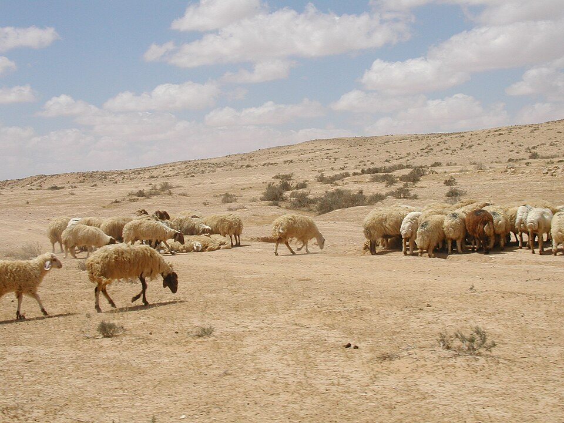

## September 2026
# How many sheep and goats fit in a Neolithic boat?
*“The reduced variability of small populations is not always due to accidental gene loss, but sometimes to the fact that the entire population was started by a single pair or by a single fertilized female”*, by Ernst Mayr, Systematics and the Origin of Species (1942).

&nbsp;

## Farming takes two roads into Europe
Sheep and goats were among the first animals domesticated in southwest Asia, with goat management already under way in the Zagros Mountains some 10,000 years ago [**1,2**]. From there, farming reached Europe along two broad routes. One ran inland along the Danube and moved slowly. The other followed the northern Mediterranean coast and moved remarkably fast, a speed that archaeologists and geneticists have linked to people travelling by boat [**3,4**]. A fast, seaborne expansion raises an obvious question for anyone working on domestic animal evolution. How many animals can you fit in a Neolithic boat? If early farmers carried only small herds, their livestock should carry the genetic signature of a founder event where few animals initiated subsequent population expansions [**5**].

&nbsp;

<em>A sheep herd grazing near Revivim at the Negev desert. Photo via Wikimedia Commons, CC BY-SA 4.0.</em>

&nbsp;

In her AaRCTikTalk, Áine Halpin showed how these routes shaped the genetic diversity of Neolithic sheep and goats during their expansion across Europe. To do so, she generated new palaeogenomes from early Neolithic sheep and goats at two sites in northeast Iberia, the lakeside settlement of La Draga and the cave of Cova de l'Avellaner, both dated to roughly 5,300 to 4,700 cal BCE. Further genomes came from Le Taï in southern France, Santa Verna in Malta and Sarakenos Cave in Greece.
In total, Áine and her collaborators added 16 new genomes (6 goats and 10 sheep) and analysed them together with published data from about 99 ancient goats and 121 ancient sheep. As is often the case with ancient material, coverage was low and uneven, from 0.17× to 11.21× with a median of 1.38×. Rather than limit the analyses to the few well-covered genomes, the authors imputed genotypes with GLIMPSE, which allowed haplotype-based methods such as calculating runs of homozygosity (ROH) and identity-by-descent (IBD) sharing [**6**]. As Áine explained, to her knowledge this was the first time imputation has been tested in ancient sheep.
&nbsp;

## Few founders, long shadows
Jointly with Dr. Jolijn Erven, Áine analyzed these ancient genomes and found that goats and sheep from La Draga and Cova de l'Avellaner had the lowest genetic diversity of any population in the dataset, well below early managed goats from the Zagros, hunted mouflons from Lebanon, and sheep in Neolithic Istanbul (Yenikapı), with Neolithic goats and sheep from Serbia sitting in between. Their genomes were also full of ROH segments. Iberian goats carried mostly small-to-medium tracts (0.5 to 4 Mb), covering on average 23.2% of the genome, while long tracts were rare. That pattern points to a population that stayed small for many generations rather than to mating between close relatives. The authors suggest that herd management, such as controlling which males sired offspring, may have helped herders avoid close inbreeding [**6**]. Estimates of effective population size for goats gave an Ne of about 1,760 for the early Zagros herd at Ganj Dareh, about 1,228 for Neolithic Serbia, and only about 205 (95% CI 162 to 248) for northeast Iberia. Forward simulations gave a similar range of roughly 200 to 400. Sheep followed the same trend, from about 5,862 in Serbia to about 1,386 in Iberia, although with much wider confidence intervals [**6**].
&nbsp;

## Hopping along the coast
IBD sharing showed how these herds were connected. Goats formed a European cluster, driven by strong sharing among the Iberian goats, distinct from clusters in the Zagros and in northeast Iran and Turkmenistan. Sheep from northeast Iberia and southern France also shared many IBD segments, which the authors read as a sign of contact by sea rather than over the Pyrenees.
Putting this together, Áine argued that marine migration routes might have made a rapid initial spread possible but did not keep livestock flowing from southwest Asia afterwards. Goats seem to have gone through a harsher and longer bottleneck than sheep, which the authors suggest may reflect regional isolation, culling for meat and small founding herds. In contrast, sheep appear to have moved between communities more often, in line with a stepwise coastal (cabotage) model of dispersal across the Mediterranean.
&nbsp;

## What to learn from ancient livestock migrations
This study shows how much information can still be pulled out of low-coverage ancient genomes when the right tools are applied, where statistical imputation methods turned a set of mostly fragmentary and low-coverage genomes into data suitable for advanced genomic population analyses usually reserved for modern data. These in turn revealed demographic dynamics that diversity estimates alone could only hint at, and point to possible herding practices.
However, some caveats still apply that warrant caution for these results. The estimates for sheep genomes are uncertain, and the authors themselves advise against comparing Ne directly between species. The links to herding practices come from the archaeological and ethnographic context and were not tested directly in the study presented here. Still, these results give a clear genomic picture of what a fast, seaborne Neolithic expansion may have cost the animals that came along with their human herders.

&nbsp;

## References
1.	[Zeder MA, Hesse B. The initial domestication of goats (*Capra hircus*) in the Zagros Mountains 10,000 years ago. Science 287: 2254–2257 (2000).]
2.	[Daly KG, et al. Herded and hunted goat genomes from the dawn of domestication in the Zagros Mountains. Proceedings of the National Academy of Sciences 118: e2100901118 (2021).]
3.	[Pinhasi R, Fort J, Ammerman AJ. Tracing the origin and spread of agriculture in Europe. PLoS Biology 3: e410 (2005).]
4.	[Isern N, et al. Modeling the role of voyaging in the coastal spread of the Early Neolithic in the West Mediterranean. Proceedings of the National Academy of Sciences 114: 897–902 (2017).]
5.	[Peter BM, Slatkin M. The effective founder effect in a spatially expanding population. Evolution 69: 721–734 (2015).]
6.	[Halpin Á, Erven JAM, Alcàntara Fors R, et al. Mediterranean dispersal imposed bottlenecks in Neolithic sheep and goats. bioRxiv. 10.64898/2026.07.21.739115 (2026).]

[Zeder MA, Hesse B. The initial domestication of goats (*Capra hircus*) in the Zagros Mountains 10,000 years ago. Science 287: 2254–2257 (2000).]:https://www.science.org/doi/10.1126/science.287.5461.2254
[Daly KG, et al. Herded and hunted goat genomes from the dawn of domestication in the Zagros Mountains. Proceedings of the National Academy of Sciences 118: e2100901118 (2021).]:https://doi.org/10.1073/pnas.2100901118
[Pinhasi R, Fort J, Ammerman AJ. Tracing the origin and spread of agriculture in Europe. PLoS Biology 3: e410 (2005).]:https://doi.org/10.1371/journal.pbio.0030410
[Isern N, et al. Modeling the role of voyaging in the coastal spread of the Early Neolithic in the West Mediterranean. Proceedings of the National Academy of Sciences 114: 897–902 (2017).]:https://doi.org/10.1073/pnas.1613413114
[Peter BM, Slatkin M. The effective founder effect in a spatially expanding population. Evolution 69: 721–734 (2015).]:https://academic.oup.com/evolut/article/69/3/721/6852110
[Halpin Á, Erven JAM, Alcàntara Fors R, et al. Mediterranean dispersal imposed bottlenecks in Neolithic sheep and goats. bioRxiv. 10.64898/2026.07.21.739115 (2026).]:https://www.biorxiv.org/content/10.64898/2026.07.21.739115v1

&nbsp;

Below, Áine shared with us further details about her profile, career, prospects and future projects:
&nbsp;

**1. Briefly introduce yourself. What is your origin story for how you got into science?**  
I always had a strong interest in science in school but hadn't quite figured out what I wanted to focus on, so I chose to study general science at university. I specialised in genetics in my third year and found my passion for palaeogenomics there. My capstone project was in the Bradley lab at TCD, where I worked on whole-genome capture of ancient sheep DNA. During this project I was introduced to bioinformatics. After finishing my undergraduate degree I wanted to improve my computational skills, so I completed a master's in computational genomics at the University of Galway, but I wanted to return to the world of palaeogenomics. I then returned to the Bradley lab for my PhD project, focusing on ancient sheep from across Eurasia.
&nbsp;

**2. How and/or why did you start working on this project?**  
Having had a taster of this work during my undergrad, it was something I knew I wanted to return to and continue working on. I also come from a long line of sheep farmers, so sheep farming has played a huge part in my life and that of my ancestors. I think because of that I always had a natural interest in the first sheep farmers and how farming has evolved up to the present day.
&nbsp;

**3. Were there any major challenges in this project? How did you overcome them?**  
Naturally with ancient DNA, the most common problem I met was very damaged, low-yield samples, which can be frustrating when a sample is of particular interest. Luckily for me, our lab manager has optimised all our wet-lab protocols so we can get the most from our samples, but even then, sometimes it is not enough for the depth of analysis you want. I then aimed to tackle the issue bioinformatically using genotype imputation. It had not been tested in ancient sheep, but thankfully it was quite successful for my dataset.
&nbsp;

**4. What do you think are the main take-home messages of this project?**  
For me, the main take-home message would be the success of genotype imputation in ancient sheep. It has really broadened the types of analysis we can apply to our dataset and expanded how much information we can get from our samples. For example, it allowed for ROH and IBD analyses, which let us identify a Mediterranean-specific bottleneck in the Neolithic, the focus of our recent manuscript submission. I think this emphasises how new techniques are always being developed to optimise and broaden potential analyses: never assume a sample is exhausted of information.
&nbsp;

**5. What do you think is missing in the field that you would like to work on?**  
If I had a little more time with this project, it would be great to investigate the Y chromosome in our dataset and see what patterns jump out. It is a real missing piece that I think could fill in a lot of blanks about the motivations and methods of farming for the people of the past.
&nbsp;

**6. Where do you see yourself in the near future?**  
Since completing my project I have been working in animal health research and development, but I would like to work towards publishing more of my ancient sheep samples so they are available for the research community to use in their own research.
